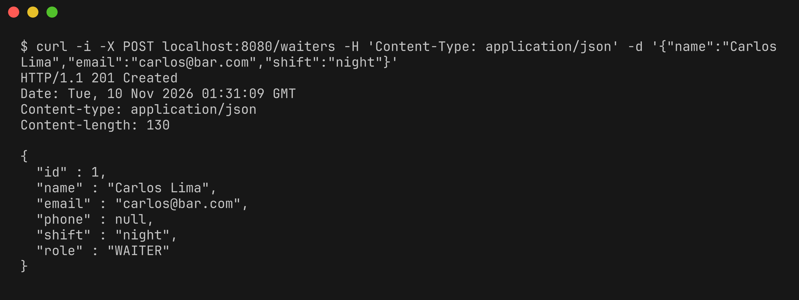
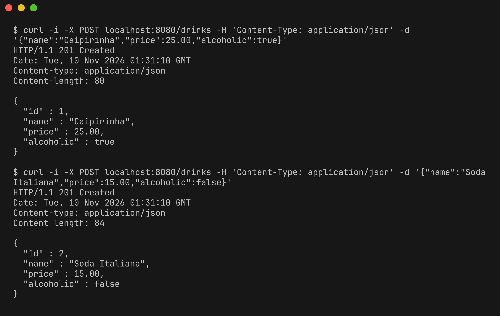
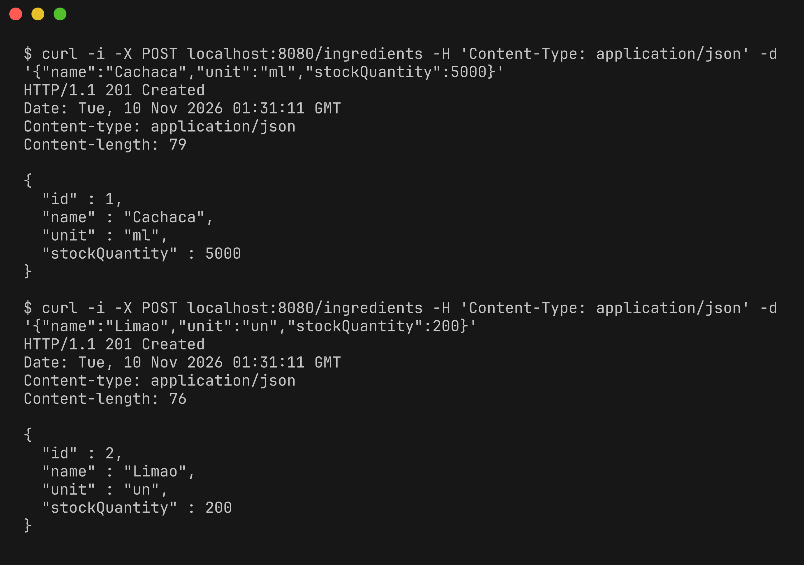
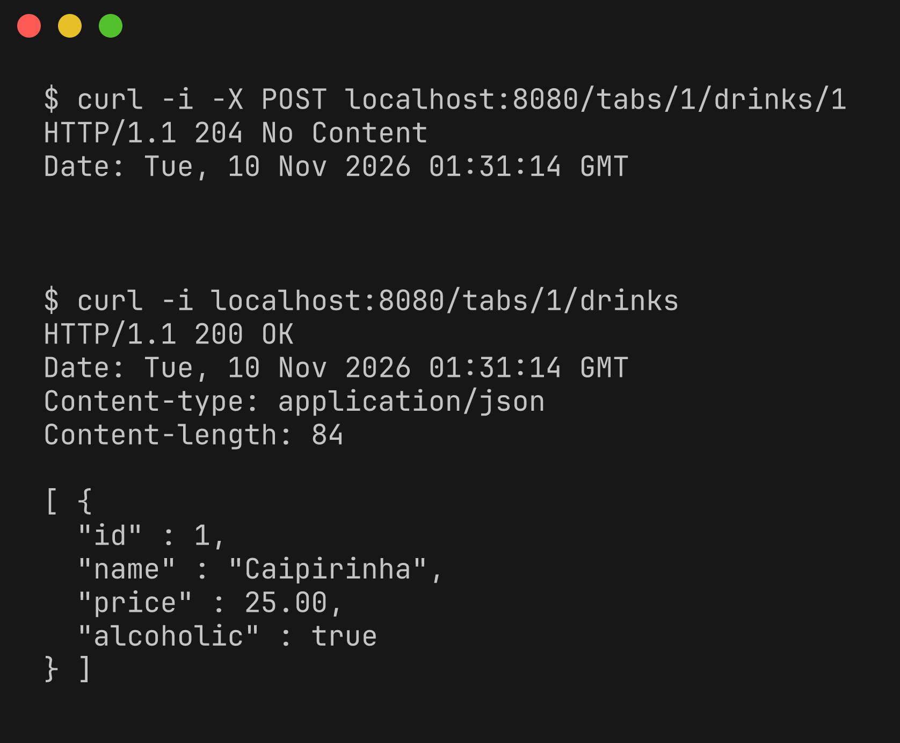
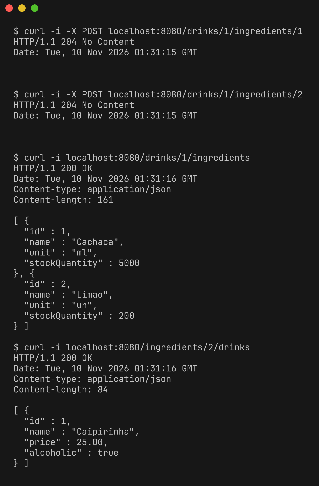
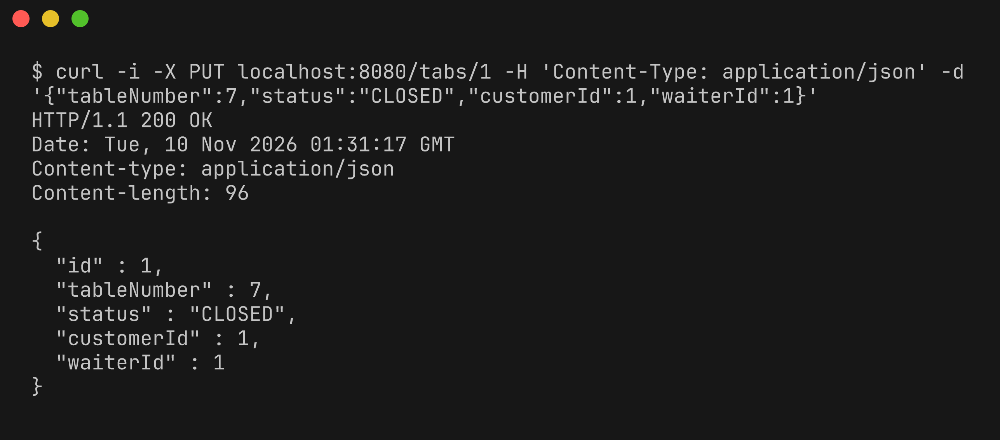
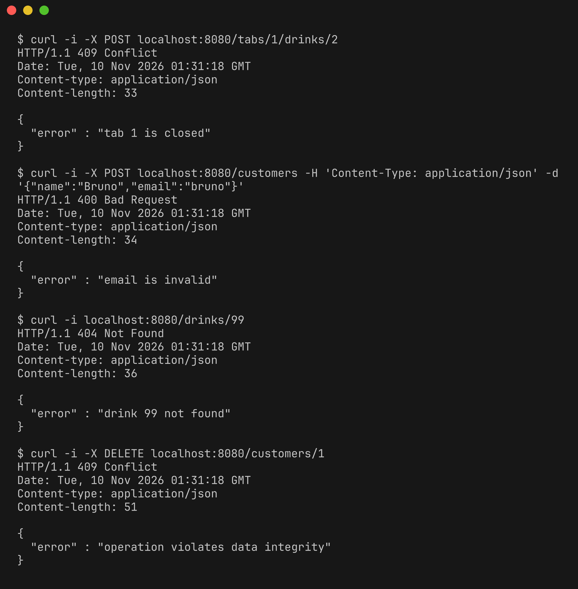
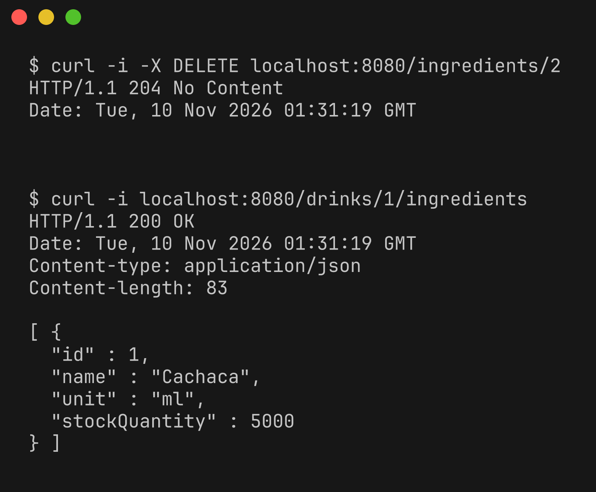

# Bar API

API REST para gerenciar um bar: clientes, garçons, comandas, drinks e ingredientes.

Feita só com Java 21 (JDK puro, `com.sun.net.httpserver`), JDBC, banco H2 embarcado em arquivo e Jackson para JSON. Sem frameworks.

## Modelo

- `Customer` (cliente) 1..N `Tab` (comanda)
- `Waiter` (garçom) 1..N `Tab`
- `Tab` N..N `Drink` (tabela `tab_drinks`)
- `Drink` N..N `Ingredient` (tabela `drink_ingredients`)
- `Person` (abstrata) é herdada por `Customer` e `Waiter`

Uma comanda com status `CLOSED` não aceita novos drinks.

## Requisitos

- JDK 21 ou superior (`java -version`)
- Não precisa instalar o Maven, o projeto usa o Maven Wrapper (`mvnw`)

## Compilar e gerar o jar

Linux/macOS:

```bash
./mvnw clean package
```

Windows:

```bash
mvnw.cmd clean package
```

O jar fica em `target/bar-api.jar`.


## Executar

```bash
java -jar target/bar-api.jar
```

A API sobe em `http://localhost:8080`. Para usar outra porta: `java -jar target/bar-api.jar 9090`.

O banco é criado automaticamente em `data/bar.mv.db` na primeira execução. Para zerar os dados, apague a pasta `data`.


## Endpoints

| Método | Rota | Descrição |
| --- | --- | --- |
| GET, POST | `/customers` | lista / cria clientes |
| GET, PUT, DELETE | `/customers/{id}` | busca / atualiza / remove |
| GET | `/customers/{id}/tabs` | comandas do cliente |
| GET, POST | `/waiters` | lista / cria garçons |
| GET, PUT, DELETE | `/waiters/{id}` | busca / atualiza / remove |
| GET | `/waiters/{id}/tabs` | comandas atendidas pelo garçom |
| GET, POST | `/tabs` | lista / abre comandas |
| GET, PUT, DELETE | `/tabs/{id}` | busca / atualiza (ex.: fechar) / remove |
| GET | `/tabs/{id}/drinks` | drinks da comanda |
| POST, DELETE | `/tabs/{id}/drinks/{drinkId}` | adiciona / remove drink da comanda |
| GET, POST | `/drinks` | lista / cria drinks |
| GET, PUT, DELETE | `/drinks/{id}` | busca / atualiza / remove |
| GET | `/drinks/{id}/ingredients` | ingredientes do drink |
| POST, DELETE | `/drinks/{id}/ingredients/{ingredientId}` | vincula / desvincula ingrediente |
| GET, POST | `/ingredients` | lista / cria ingredientes |
| GET, PUT, DELETE | `/ingredients/{id}` | busca / atualiza / remove |
| GET | `/ingredients/{id}/drinks` | drinks que usam o ingrediente |

## Exemplos

Criar cliente


Criar garçom



Criar drinks



Criar ingredientes



Abrir comanda


Listar drinks


Relacionamentos 1..N


Drinks na comanda (N..N entre comanda e drink)



Ingredientes do drink (N..N entre drink e ingrediente)



Fechar comanda



Erros: comanda fechada, validação, não encontrado e conflito



Remover


