# Bar API

API REST para gestão de comandas de um bar: clientes, comandas, categorias, itens do cardápio e promoções.

Feita só com Java 21 (JDK puro, `com.sun.net.httpserver`), JDBC, banco H2 embarcado em arquivo e Jackson para JSON. Sem frameworks.

## Modelo

- `Customer` (cliente) 1..N `Tab` (comanda)
- `Category` (categoria) 1..N `MenuItem` (item do cardápio: drinks, bebidas não alcoólicas, petiscos, pratos)
- `Tab` N..N `MenuItem`, com quantidade (tabela `tab_items`)
- `Promotion` (promoção) N..N `MenuItem` (tabela `promotion_items`)

Regras:

- O garçom é um atributo da comanda e os ingredientes ficam na descrição do item.
- O total da comanda aplica o maior desconto entre as promoções ativas de cada item.
- Uma comanda com status `CLOSED` não aceita alterações nos itens.

## Requisitos

- JDK 21 ou superior (`java -version`)
- Não precisa instalar o Maven, o projeto usa o Maven Wrapper (`mvnw`)

## Compilar e gerar o jar

Linux/macOS:

```bash
./mvnw clean package
```

Windows:

```bash
mvnw.cmd clean package
```

O jar fica em `target/bar-api.jar`.

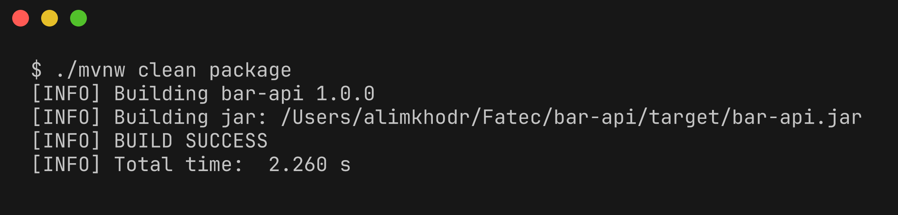

## Executar

```bash
java -jar target/bar-api.jar
```

A API sobe em `http://localhost:8080`. Para usar outra porta: `java -jar target/bar-api.jar 9090`.

O banco é criado automaticamente em `data/bar.mv.db` na primeira execução. Para zerar os dados, apague a pasta `data`.

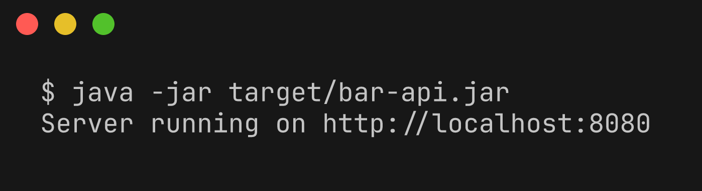

## Endpoints

| Método | Rota | Descrição |
| --- | --- | --- |
| GET, POST | `/customers` | lista / cria clientes |
| GET, PUT, DELETE | `/customers/{id}` | busca / atualiza / remove |
| GET | `/customers/{id}/tabs` | comandas do cliente |
| GET, POST | `/tabs` | lista / abre comandas |
| GET, PUT, DELETE | `/tabs/{id}` | busca / atualiza (ex.: fechar) / remove |
| GET, POST | `/tabs/{id}/items` | itens da comanda / adiciona item (`{"itemId":1,"quantity":2}`) |
| DELETE | `/tabs/{id}/items/{itemId}` | remove item da comanda |
| GET | `/tabs/{id}/total` | total da comanda com descontos |
| GET, POST | `/categories` | lista / cria categorias |
| GET, PUT, DELETE | `/categories/{id}` | busca / atualiza / remove |
| GET | `/categories/{id}/items` | itens da categoria |
| GET, POST | `/items` | lista / cria itens do cardápio |
| GET, PUT, DELETE | `/items/{id}` | busca / atualiza / remove |
| GET | `/items/{id}/promotions` | promoções do item |
| GET, POST | `/promotions` | lista / cria promoções |
| GET, PUT, DELETE | `/promotions/{id}` | busca / atualiza / remove |
| GET | `/promotions/{id}/items` | itens da promoção |
| POST, DELETE | `/promotions/{id}/items/{itemId}` | inclui / retira item da promoção |

## Exemplos

Criar cliente

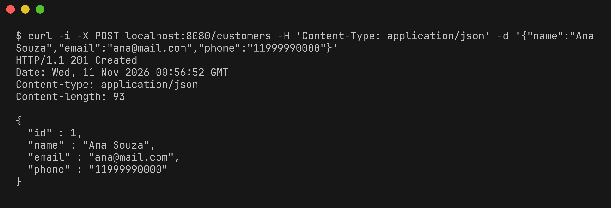

Criar categorias

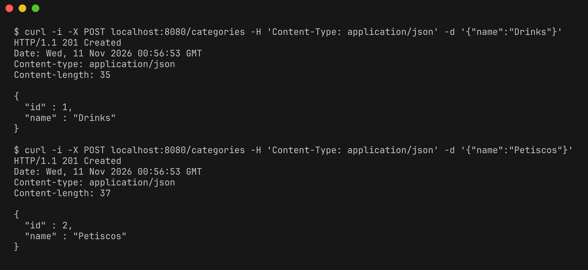

Criar itens do cardápio

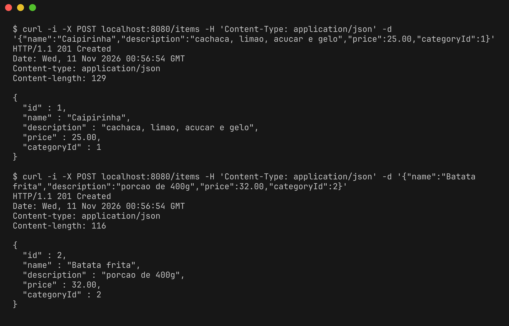

Criar promoção

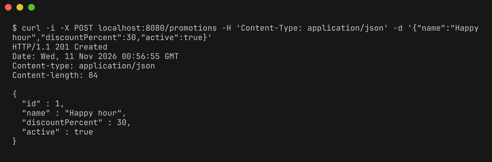

Abrir comanda

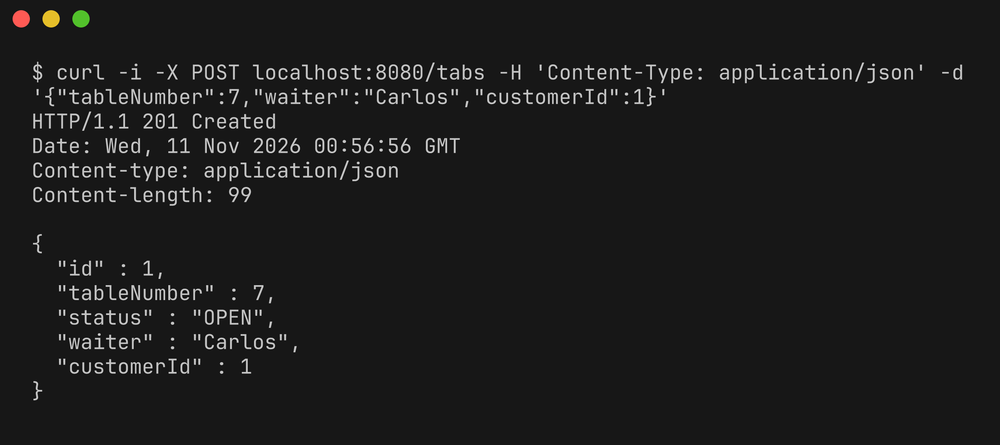

Listar itens do cardápio

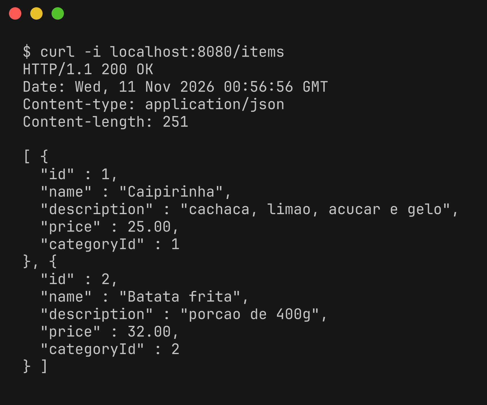

Relacionamentos 1..N

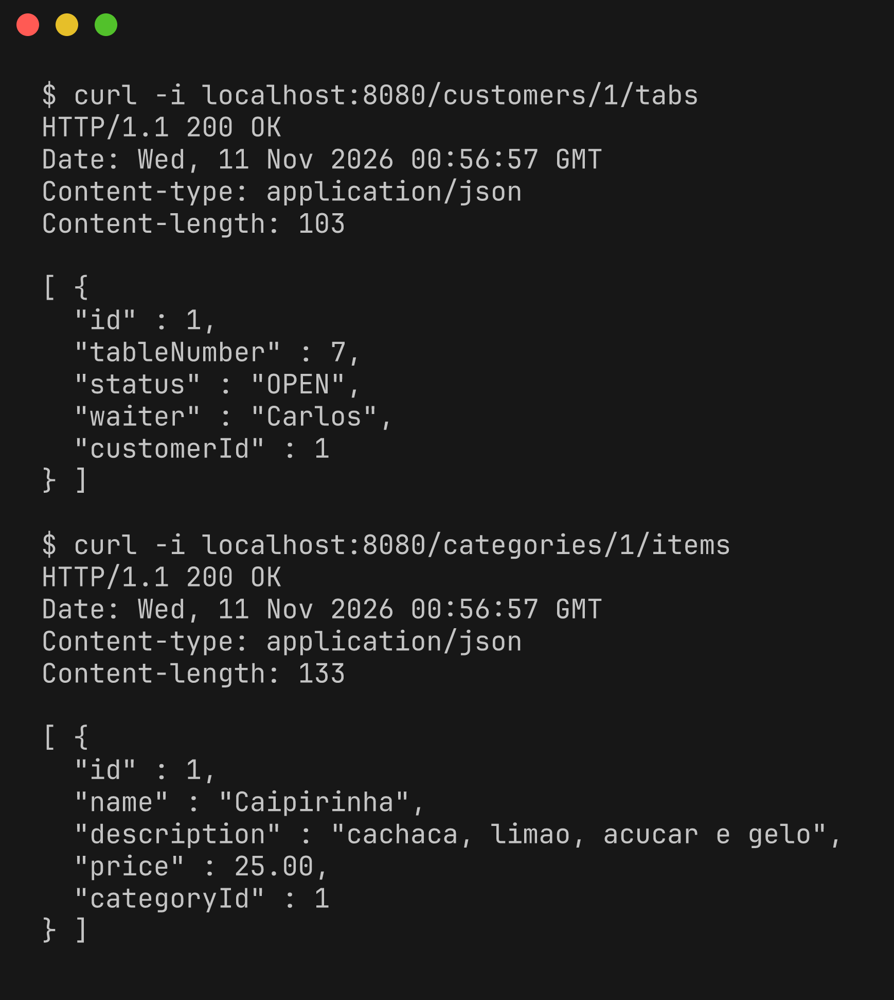

Itens da promoção (N..N entre promoção e item)

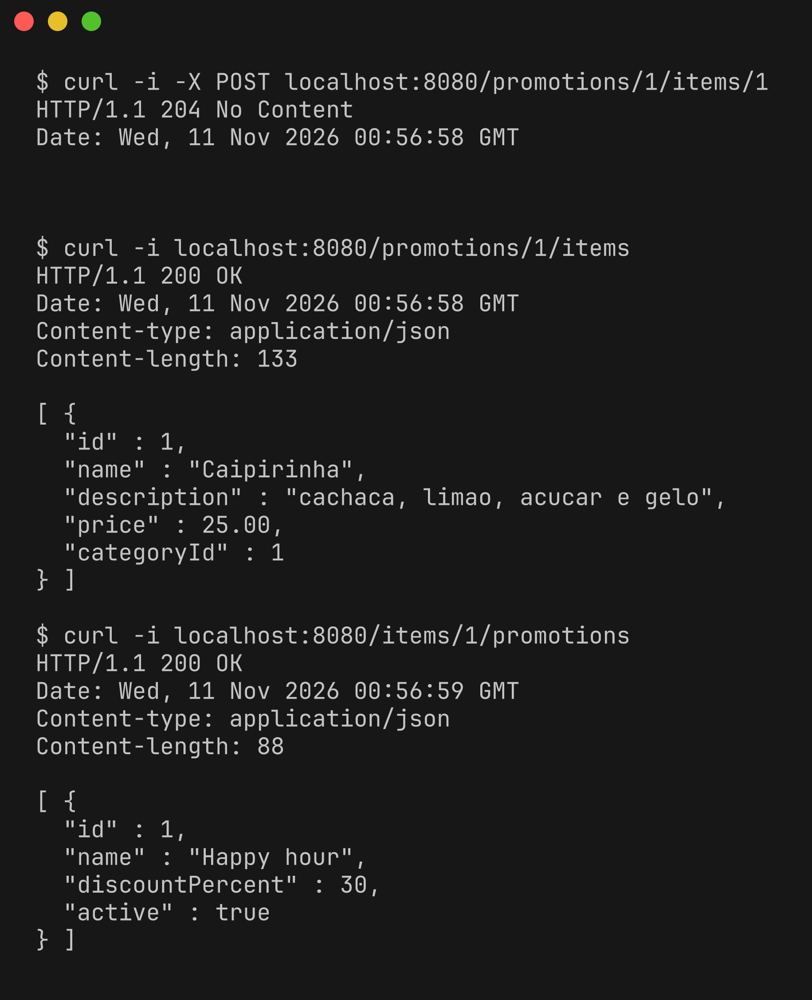

Adicionar item na comanda (N..N entre comanda e item, com quantidade)

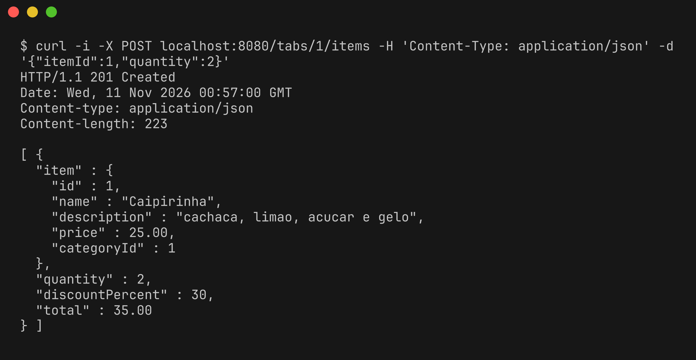

Total da comanda com desconto da promoção

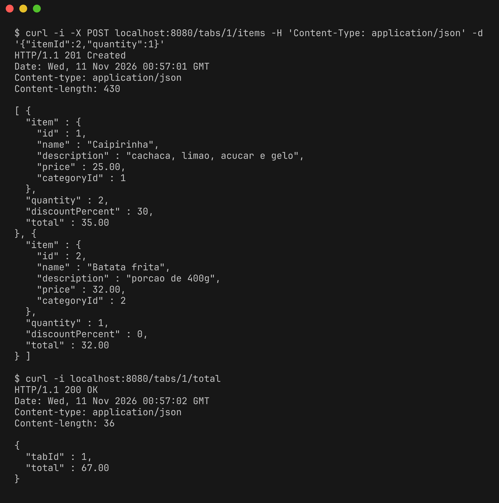

Fechar comanda

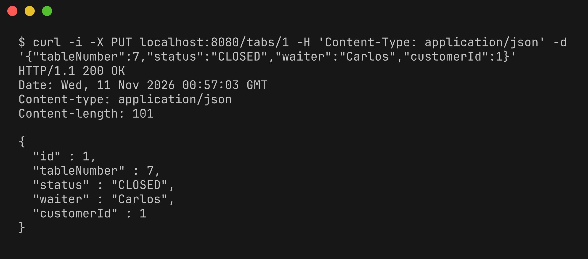

Erros: comanda fechada, validação, não encontrado e conflito

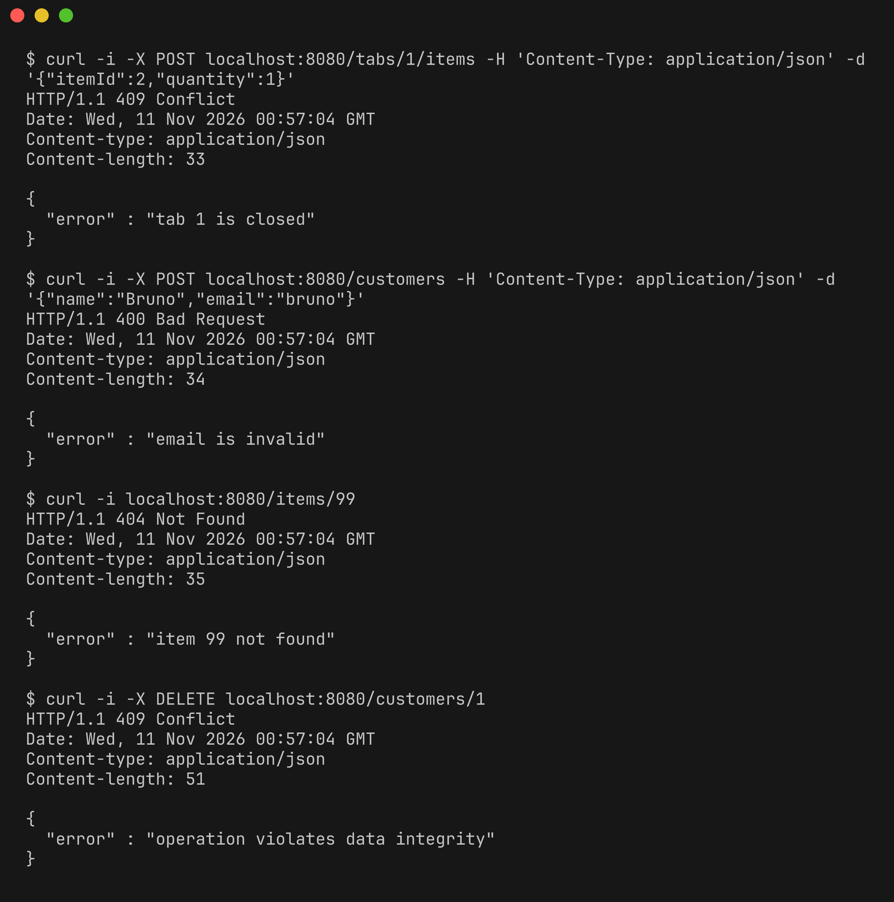

Remover

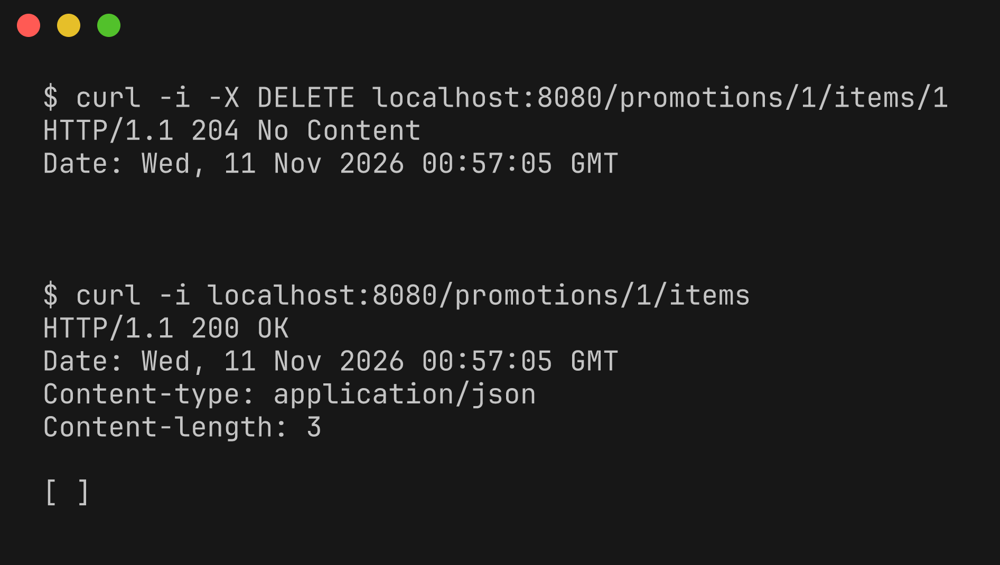
